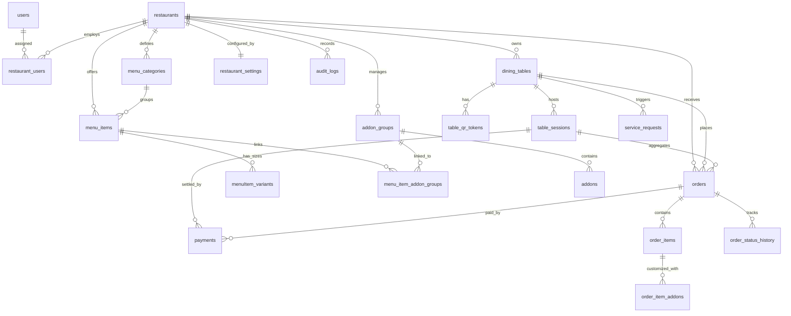

# Matrix Cravio — Entity-Relationship (ER) Documentation

## Relational Architecture Overview

Matrix Cravio uses a normalized PostgreSQL relational database engineered for multi-tenant isolation, immutable order item auditing, decimal-safe financial calculations, and high-frequency real-time updates.

---

## Entity Descriptions

### 1. `users`
System actors across the platform.
- `id`: UUID (Primary Key)
- `email`: VARCHAR(255) (Unique)
- `password_hash`: VARCHAR(255) (Bcrypt)
- `full_name`: VARCHAR(150)
- `phone`: VARCHAR(30)
- `system_role`: VARCHAR(30) (`superadmin`, `user`)
- `is_active`: BOOLEAN

### 2. `restaurants`
Tenant establishment entity.
- `id`: UUID (Primary Key)
- `name`: VARCHAR(150)
- `slug`: VARCHAR(150) (Unique)
- `tax_percentage`: DECIMAL(5, 2)
- `service_charge_percentage`: DECIMAL(5, 2)
- `currency_symbol`: VARCHAR(10) (e.g. `₹`, `$`)
- `allow_ordering`: BOOLEAN
- `auto_accept_orders`: BOOLEAN

### 3. `dining_tables`
Physical restaurant tables.
- `id`: UUID (Primary Key)
- `restaurant_id`: UUID (FK -> `restaurants.id`)
- `table_number`: VARCHAR(50) (e.g. `T-01`)
- `display_name`: VARCHAR(100) (e.g. `Window Side Booth`)
- `zone`: VARCHAR(50) (`Indoor Dining`, `Terrace Garden`, `VIP Lounge`, `Bar`)
- `capacity`: INTEGER
- `status`: VARCHAR(30) (`available`, `occupied`, `reserved`, `maintenance`)

### 4. `table_qr_tokens`
Cryptographically secure URL-safe scanning tokens.
- `id`: UUID (Primary Key)
- `restaurant_id`: UUID (FK -> `restaurants.id`)
- `table_id`: UUID (FK -> `dining_tables.id`)
- `token`: VARCHAR(128) (Unique, Cryptographic)
- `is_revoked`: BOOLEAN
- `expires_at`: TIMESTAMPTZ

### 5. `menu_categories` & `menu_items`
Hierarchical food and beverage catalog.
- Categories support display ordering and icon associations.
- Items feature dietary flags (`veg`, `non_veg`, `vegan`, `egg`), spiciness levels (0-3), allergen tags, preparation time estimates, and instant 86-ing (`is_available`).

### 6. `menu_item_variants` & `addons`
Portion sizing (10-inch, 12-inch, Single/Double Patty) and add-on grouping (Dips, Extra Cheeses, Toppings) with min/max selection bounds.

### 7. `table_sessions`
Active guest visit tracking that allows multiple order rounds to be placed from the same table and consolidated into a unified bill.

### 8. `orders` & `order_items`
- State machine lifecycle: `PENDING` -> `ACCEPTED` -> `PREPARING` -> `READY` -> `SERVED` -> `COMPLETED`.
- Snapshots: Unit prices, names, and modifiers are frozen in `order_items` and `order_item_addons` upon checkout to guarantee historical price immutability.
